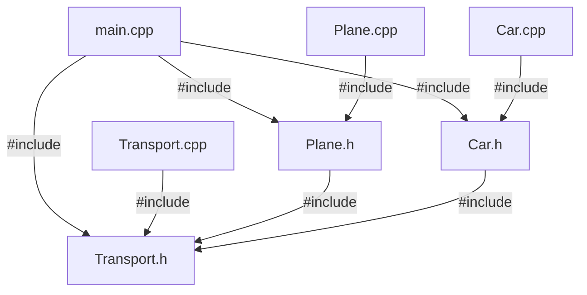
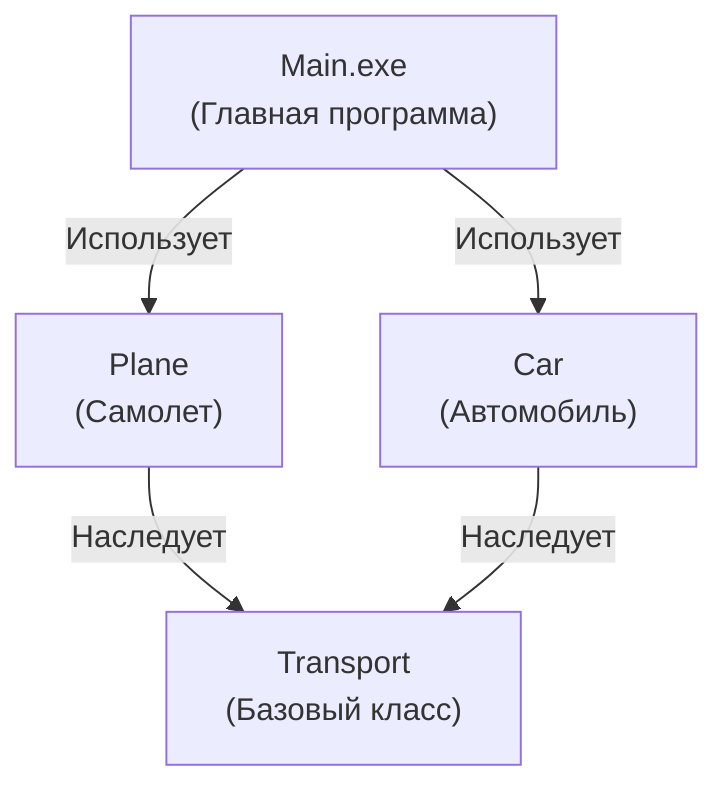

# Группа: ИКТГ-2522
Владелец репозитория: Калганова Екатерина\
Состав коллектива: Калганова Екатерина, Пимахина Юлия\
Вариант №16\
Реализация транспортных средств (поиск самого нового)

***

<h2>Базовый класс (transport)</h2>

transport.h
```cpp
#ifndef TRANSPORT_H
#define TRANSPORT_H

#include <iostream>
#include <string.h>
using namespace std;

class Transport {
public:
    Transport();
    int getYear();
    virtual void show();
    void setBrand(const char* b);
    void setYear(int y);

protected:
    char brand[30];
    int year;     
};

#endif
```
transport.cpp

```cpp
#include "transport.h"

Transport::Transport() {
    strcpy(brand, "NoBrand");
    year = 0;
}

int Transport::getYear() {
    return year;
}

void Transport::show() {
    cout << "Марка: " << brand << " | Год: " << year << endl;
}

void Transport::setBrand(const char* b) {
    strcpy(brand, b);
}

void Transport::setYear(int y) {
    year = y;
}
```

<h2>Класс-наследник 1 (plane)</h2>
plane.h

```cpp
#ifndef PLANE_H
#define PLANE_H

#include "transport.h"

class Plane : public Transport {
public:
    Plane(const char* b, int y, int alt);
    void setAltitude(int alt);
    void show();
private:
    int altitude;
};

#endif
```

plane.cpp
```cpp
#include "plane.h"

Plane::Plane(const char* b, int y, int alt) {
    strcpy(brand, b); 
    year = y;
    altitude = alt;
}

void Plane::setAltitude(int alt) {
    altitude = alt;
}

void Plane::show() {
    cout << "[Самолет] Марка: " << brand << " | Год: " << year << " | Высота: " << altitude << "м" << endl;
}
```

<h2>Класс-наследник 2 (car)</h2>

car.h
```cpp
#ifndef CAR_H
#define CAR_H

#include "transport.h"

class Car : public Transport {
public:
    Car(const char* b, int y, int s); 
    void setSpeed(int s); 
    void show(); 
private:
    int speed;
};

#endif
```
car.cpp

```cpp
#include "car.h"

Car::Car(const char* b, int y, int s) {
    strcpy(brand, b);
    year = y;
    speed = s;
}

void Car::setSpeed(int s) {
    speed = s;
}

void Car::show() {
    cout << "[Машина] Марка: " << brand << " | Год: " << year << " | Макс. скорость: " << speed << " км/ч" << endl;
}
```

<h2>Диаграмма файлов</h2>




<h2>Диаграмма компонентов</h2>



<h2>Файл main.cpp</h2>

```cpp
#include <iostream>
#include "transport.h"
#include "plane.h"
#include "car.h"

using namespace std;

int main() {
    Plane p1("Boeing", 2015, 10000);
    Plane p2("Airbus", 2020, 11000);
    Car c1("Toyota", 2018, 220);
    Car c2("BMW", 2023, 250);

    Transport* ps[4];
    ps[0] = &p1;
    ps[1] = &p2;
    ps[2] = &c1;
    ps[3] = &c2;

    int choice = 0;

    while (true) {
        cout << "\n--- Меню ---\n";
        cout << "1. Показать весь транспорт\n";
        cout << "2. Изменить год транспорта (через индекс)\n";
        cout << "3. Найти новейший транспорт\n";
        cout << "4. Выйти\n";
        cout << "Выбрать действие: ";
        cin >> choice;

        if (choice == 1) {
           for (int i = 0; i < 4; i++) {
                cout << i << ": ";
                ps[i]->show(); 
            }
        } 
        else if (choice == 2) {
            int index, newYear;
            cout << "Выберите индекс транспорта (0 - 3): ";
            cin >> index;
            if (index >= 0 && index < 4) {
                cout << "Укажите новый год: ";
                cin >> newYear;
                ps[index]->setYear(newYear);
                cout << "Дело сделано)\n";
            } else {
                cout << "Не тот индекс емае\n";
            }
        } 
        else if (choice == 3) {
            int maxYear = 0;
            int maxIndex = 0;
            
            for (int i = 0; i < 4; i++) {
                if (ps[i]->getYear() > maxYear) {
                    maxYear = ps[i]->getYear();
                    maxIndex = i;
                }
            }
            cout << "\n--- САМЫЙ НОВЕЙШИЙ ТРАНСПОРТ ЭТО: ---\n";
            ps[maxIndex]->show();
        } 
        else if (choice == 4) {
            cout << "выходим...\n";
            break;
        } 
        else {
            cout << "Не то выбрал. Попробуй заново\n";
        }
    }

    return 0;
}
```

<h2>Демонстрация работы программы</h2>

https://github.com/user-attachments/assets/c116694e-531c-46c0-97c7-b62173597991

<h2>Заключение</h2>
В ходе выполнения лабораторной работы был изучен механизм открытого наследования в языке C++. Создан базовый класс «transport» и производные классы «plane» и «car». Была реализована виртуальная функция для обеспечения полиморфизма, а также разработана программа с консольным меню, обрабатывающая массив указателей на базовый класс и вычисляющая НОВЕЙШЕЕ транспортное средство.

<div align="center">
  
</div>
